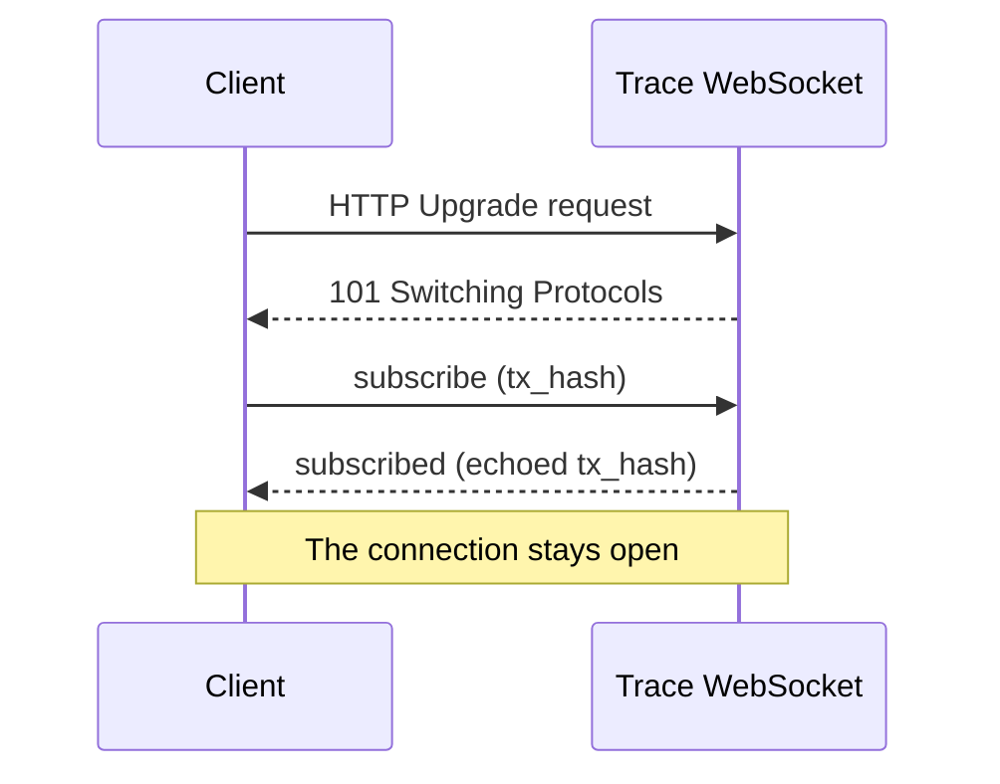

The trace module's `createTraceStream(port)` starts a standalone WebSocket listener. The Fastify application does not mount this listener. Connect to the root of the port passed to `createTraceStream`.

## Subscribe handshake

After the WebSocket opens, send a JSON message with `type: "subscribe"` and a transaction hash in `tx_hash`. The handler checks that `tx_hash` is truthy, then echoes it in a `subscribed` message. This acknowledgement only confirms receipt. The handler leaves the connection open and does not start a trace. It ignores messages that do not match the subscription condition and logs JSON parsing failures without replying.



## Trace message types

`TraceStreamMessage` declares six discriminants, an optional string `trace_id`, and an open payload. The table describes fields consumed by the web client's callbacks and when a trace producer would send each message. The standalone listener currently emits only `subscribed`, so these payloads and their ordering are not enforced by the listener.

| Type | Payload fields used by the web client | Intended lifecycle |
| --- | --- | --- |
| `trace_started` | `tx_hash` (string), `ledger_sequence` (number) | Opens trace processing. |
| `trace_node` | `node` (trace node), `path` (array of numeric indices) | Adds an execution node while the trace is in progress. |
| `resource_update` | `cpu_used`, `cpu_limit`, `memory_used`, `memory_limit`, `read_bytes`, `read_limit`, `write_bytes`, `write_limit` (all numbers) | Updates resource counters during the trace. |
| `state_diff_entry` | `key`, `change_type` (strings), `before`, `after` (optional strings) | Reports a ledger change during the trace. |
| `trace_completed` | `total_nodes`, `duration_ms` (numbers) | Ends trace processing with a summary. |
| `trace_error` | `error` (string) | Ends trace processing with an error. |

## Try the handshake with wscat

With workspace dependencies installed, start the standalone listener from the repository root.

```sh
pnpm --filter grat-server exec tsx -e 'import { createTraceStream } from "./src/ws/trace-stream"; createTraceStream(3002)'
```

In another terminal, connect with `wscat`.

```sh
npx --yes wscat -c ws://localhost:3002
```

At the prompt, send the first JSON line below. The second line is the expected response.

```text
> {"type":"subscribe","tx_hash":"0123456789abcdef0123456789abcdef0123456789abcdef0123456789abcdef"}
< {"type":"subscribed","tx_hash":"0123456789abcdef0123456789abcdef0123456789abcdef0123456789abcdef"}
```
