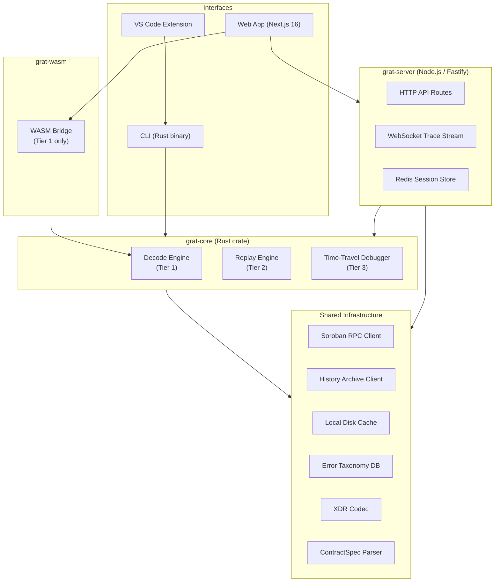
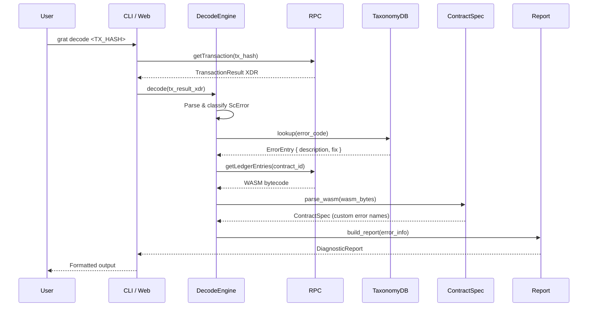
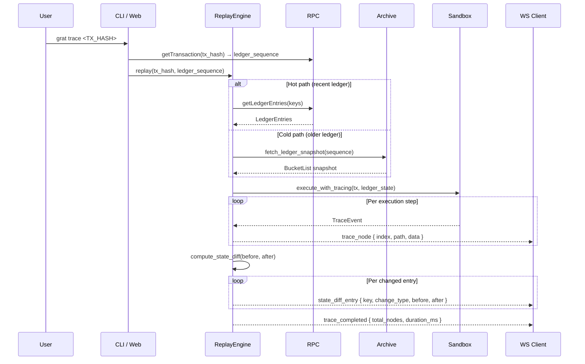
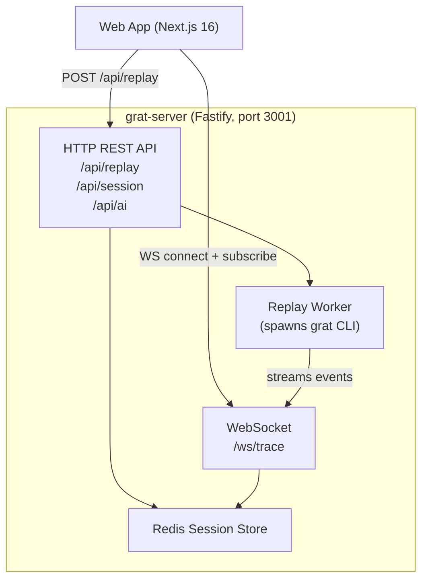

# Architecture Overview

Prism (Grat) is a modular diagnostic tool for Stellar Soroban smart contracts. This document describes the system's layered architecture, the data flow from a raw transaction hash through to a fully enriched diagnostic report, and how each component fits into the whole.

---

## High-Level Component Map



---

## Monorepo Structure

```
Prism/
├── crates/
│   ├── core/          # grat-core — all decode, replay, and debug logic
│   ├── cli/           # grat (CLI binary) — thin wrapper over grat-core
│   └── wasm/          # grat-wasm — WASM target exposing Tier 1 decode
├── apps/
│   ├── server/        # Fastify server — HTTP API + WebSocket trace stream
│   └── web/           # Next.js 16 dashboard
└── extensions/
    └── vscode/        # VS Code extension — shells out to the CLI binary
```

---

## The 3-Tier Diagnostic Engine

All diagnostic intelligence lives in `crates/core`. The three tiers are additive: Tier 2 requires Tier 1, Tier 3 requires Tier 2.

### Tier 1 — Decode Engine

**Goal:** Explain *what* went wrong.

The Decode Engine takes a failed transaction result (in XDR or JSON form), classifies the error against the taxonomy database, resolves any contract-specific error codes using the WASM contract's embedded `contractspec`, and produces a `DiagnosticReport` with a plain-English description and suggested fix.

Key source modules:
- `crates/core/src/decode/host_error.rs` — classifies `ScError` / `HostError` variants
- `crates/core/src/decode/contract_error_resolver.rs` — fetches WASM and parses `contractspec`
- `crates/core/src/decode/report.rs` — assembles the final `DiagnosticReport`
- `crates/core/src/decode/auth.rs` — detects Ed25519 vs Smart Wallet authorization types
- `crates/core/src/decode/diagnostic.rs` — processes Soroban diagnostic events

### Tier 2 — Replay Engine

**Goal:** Show *exactly how* execution reached the failure point.

The Replay Engine reconstructs the historical ledger state for the relevant ledger sequence, then re-executes the transaction inside an instrumented Soroban host sandbox. It streams each execution step as a `trace_node` event and computes a pre/post state diff.

Key source modules:
- `crates/core/src/replay/state.rs` — state reconstruction (hot/cold path)
- `crates/core/src/replay/sandbox.rs` — modified soroban-env-host with trace hooks
- `crates/core/src/replay/trace.rs` — trace event types and collector
- `crates/core/src/replay/differ.rs` — pre/post ledger state differ
- `crates/core/src/replay/profiler.rs` — CPU / memory resource profiler

### Tier 3 — Time-Travel Debugger

**Goal:** Let developers *experiment* with modified inputs without redeploying.

Built on top of the Replay Engine, the Time-Travel Debugger adds a breakpoint controller and a "What-If" engine. Breakpoints halt execution at a chosen call depth or contract invocation. The What-If engine accepts modified arguments and re-simulates the transaction to show how the outcome would change.

Key source modules:
- `crates/core/src/debugger/breakpoint.rs` — breakpoint definition and matching
- `crates/core/src/debugger/stepping.rs` — step-over / step-into logic
- `crates/core/src/debugger/whatif.rs` — non-destructive re-simulation with patched inputs

---

## Data Flow: TX Hash → Diagnostic Report



### Step-by-Step

1. **Fetch transaction** — The RPC client calls `getTransaction` with the provided hash. If the transaction succeeded (`TransactionSucceeded`), Grat exits early with an informational message.

2. **Parse XDR** — The `XdrCodec` wrapper decodes the `TransactionResultPair` envelope. Inner `ScError` / `HostError` variants are extracted and classified.

3. **Taxonomy lookup** — The error code is matched against `taxonomy/enhanced_error_taxonomy.toml`. Each entry provides a human-readable `description`, a `fix` suggestion, a `severity` level, and an optional documentation link.

4. **Contract error resolution** — If the error is a custom contract error code (e.g., `#3`), Grat fetches the contract's WASM bytecode and parses the embedded `contractspec` section to resolve the numeric code to a named variant (e.g., `InsufficientBalance`).

5. **Authorization detection** — The `auth.rs` decoder inspects every `SorobanAddressCredentials` entry and classifies each as `Ed25519` (account address, `G…`) or `Smart Wallet` (contract address, `C…`).

6. **Report assembly** — `build_report()` compiles all findings into a `DiagnosticReport` struct with fields: `error_type`, `description`, `fix`, `auth_entries`, `failing_contract_id`, `diagnostic_events`, and optionally `root_causes`.

---

## Data Flow: TX Hash → Execution Trace (Tier 2)



### State Reconstruction Paths

The Replay Engine uses two paths depending on the age of the ledger:

| Condition | Path | Data Source |
|---|---|---|
| Ledger is within ~50 000 ledgers of the network tip | **Hot path** | Soroban RPC `getLedgerEntries` |
| Ledger is older | **Cold path** | Stellar History Archive (S3/GCS) + BucketList |

The cold path fetches and decompresses the relevant `BucketList` snapshot, applies ledger closes up to the target sequence, and produces a local in-memory ledger state.

---

## WASM Bridge (Tier 1 in the Browser)

```mermaid
graph LR
    Web["Web App (Next.js)"]
    WASM["grat-wasm (.wasm)"]
    DecodeCore["grat-core\ndecode logic"]

    Web -->|"decode_error(tx_result_json)"| WASM
    WASM -->|Rust fn call| DecodeCore
    DecodeCore -->|DiagnosticReport| WASM
    WASM -->|JsValue (JSON)| Web
```

The `grat-wasm` crate compiles `grat-core`'s Tier 1 decode pipeline to WebAssembly using `wasm-bindgen` and `wasm-pack`. This allows the web frontend to decode errors **client-side**, without a round trip to the server, for fast interactive feedback.

**Exposed API:**
```typescript
// Accepts a JSON string with fields: resultXdr, diagnosticEventsXdr[], rootCauses[]
declare function decode_error(tx_result_json: string): DiagnosticReport;
```

The WASM module is initialized once via the `init()` entry point and is then available for repeated calls within the browser session.

**Limitations of the WASM bridge:**
- Tier 1 only (decode). Tier 2 replay and Tier 3 debugging require the Rust server because they need network access and significant CPU/memory.
- No persistent cache in the browser — each call is stateless.

---

## Server and Web App Interaction



### Server Responsibilities

| Route | Purpose |
|---|---|
| `POST /api/replay` | Accepts a trace request; enqueues a replay job |
| `GET /api/session/:id` | Returns a stored `DiagnosticReport` or trace session |
| `POST /api/ai` | Proxies AI explanation requests with token budget enforcement |
| `GET /health` | Health check endpoint |
| `WS /ws/trace` | Streams `trace_node`, `resource_update`, `state_diff_entry` events |

### Session Persistence

Completed traces are serialized and stored in Redis (via the `SessionStore` class) with configurable TTLs:

| Data type | Default TTL |
|---|---|
| Decode result | 24 hours |
| Execution trace | 1 hour |

Clients retrieve stored sessions by session ID for sharing and later review.

---

## Shared Infrastructure

| Module | Location | Description |
|---|---|---|
| XDR Codec | `crates/core/src/xdr/` | High-level wrappers over `stellar-xdr`; handles base64 encode/decode and type-safe deserialization |
| Soroban RPC Client | `crates/core/src/rpc/` | JSON-RPC transport with retry logic and configurable timeout |
| History Archive Client | `crates/core/src/archive/` | Parallelized fetch of ledger snapshots from Stellar public archives (S3/GCS) |
| Local Cache | `crates/core/src/cache/` | Content-addressed disk cache keyed by ledger entry hash; configurable max size |
| Error Taxonomy DB | `crates/core/src/taxonomy/` | Versioned TOML catalog of every known Soroban error code with human descriptions |
| ContractSpec Parser | `crates/core/src/spec/` | Parses WASM `contractspec` custom section to resolve custom error names |

---

## VS Code Extension

The VS Code extension (`extensions/vscode`) is intentionally thin: it **shells out to the installed `grat` CLI binary** rather than embedding any Rust logic itself. This avoids duplicating the core engine and means the extension automatically benefits from CLI upgrades.

```
VS Code Extension
  └─► spawns: grat decode <TX_HASH> --output json
       └─► pipes stdout JSON into Webview panel
```

---

## Key Design Decisions

**All logic in Rust (`grat-core`), interfaces are thin wrappers.**
This ensures correctness is tested once and shared across CLI, WASM, and server without drift.

**Tier 1 runs client-side via WASM, Tier 2–3 require the server.**
Tier 1 decode is lightweight and stateless — suitable for in-browser execution. Tier 2 replay requires fetching hundreds of MB of ledger state and spawning a modified Soroban host, which is impractical in a browser sandbox.

**Error taxonomy is community-contributable TOML, not code.**
The taxonomy lives in `taxonomy/enhanced_error_taxonomy.toml` and is versioned independently from the core binary. Updates are pulled at startup if the machine is online.

**State reconstruction uses a hot/cold path split.**
Recent transactions are fast to replay via RPC. Older ones require the history archive pipeline, which is parallelized to keep cold-path times reasonable.

**VS Code extension shells out to the CLI binary.**
No duplicate logic. The extension is a thin UI wrapper — the CLI is the single source of truth for diagnostics.
