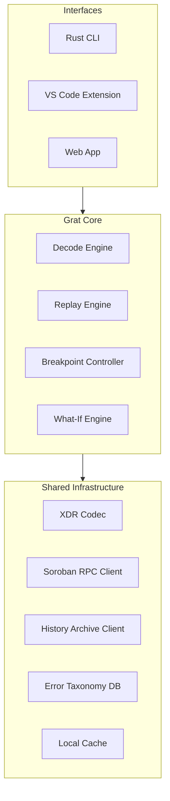
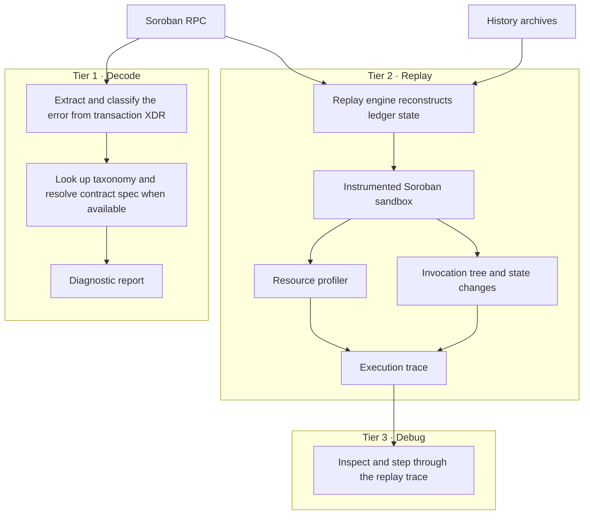

Grat is organized into a core library that all interfaces share, a shared infrastructure layer for network and data access, and multiple interface targets.

## Component Map

## Diagnostic Data Flow

The [Decode Engine](/architecture/decode-engine) uses transaction results and
diagnostic events to explain failures. The [Replay Engine](/architecture/replay-engine)
reconstructs state and runs the transaction in an instrumented host, producing
the trace the debugger consumes.

## Layers

- **Interfaces**: Consume the core logic to provide user-facing experiences.
- **Grat Core**: Implements the 3-tier diagnostic logic.
- **Shared Infrastructure**: Handles communication with the Stellar network and disk storage.
