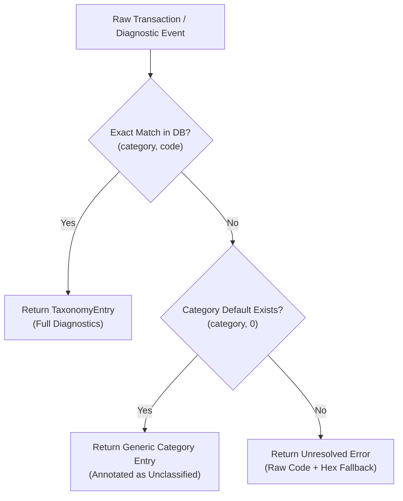

# Contributing to the Error Taxonomy

Prism's Error Taxonomy is the core knowledge base that maps cryptic Soroban host errors, VM traps, and contract aborts into actionable, plain-English explanations and diagnostic remedies.

This guide provides a complete reference for contributors authoring new error entries, outlining the TOML schema definitions, the matching and resolution pipeline in `crates/core/src/taxonomy/loader.rs`, and the validation workflow required before opening a Pull Request.

---

## 1. Architecture Overview

Error mappings in Prism are maintained in two locations:

1. **Category Data Stores (`crates/core/src/taxonomy/data/*.toml`):**  
   The primary machine-readable taxonomy consumed directly by `grat-core` during transaction analysis. Files are partitioned by category: `wasm.toml`, `budget.toml`, `auth.toml`, `storage.toml`, `object.toml`, `context.toml`, `contract.toml`, `events.toml`, `crypto.toml`, and `value.toml`.
2. **Enhanced Global Registry (`taxonomy/enhanced_error_taxonomy.toml`):**  
   The cross-referenced repository containing relationship mappings and external documentation links.

---

## 2. TOML Schema Reference

### 2.1 Category Header (`crates/core/src/taxonomy/data/*.toml`)

Each category TOML file begins with a top-level `[category]` table:

| Field | Type | Required | Description |
| :--- | :--- | :---: | :--- |
| `name` | String | **Yes** | Display name of the category (e.g. `"Wasm"`, `"Storage"`, `"Budget"`). |
| `description` | String | **Yes** | Overview of errors encompassed by this category. |
| `source_module` | String | Optional | Upstream Soroban host source file where these errors originate (e.g. `"soroban-env-host/src/host/mem_helper.rs"`). |

```toml
[category]
name = "Wasm"
description = "Errors originating from the WebAssembly virtual machine runtime, bytecode decoding, or guest memory."
source_module = "soroban-env-host/src/vm.rs"
```

### 2.2 Error Entry Fields (`[[errors]]`)

Each error is declared under an `[[errors]]` array entry:

| Field | Type | Required | Valid Values / Constraints | Description |
| :--- | :--- | :---: | :--- | :--- |
| `id` | String | **Yes** | Dot-separated identifier (e.g. `"host.wasm.unreachable_code"`) | Canonical unique identifier. |
| `category` | String | **Yes** | `"wasm"`, `"storage"`, `"budget"`, `"auth"`, `"object"`, `"context"`, `"contract"`, `"events"`, `"crypto"`, `"value"` | Target subsystem category. |
| `code` | Integer | **Yes** | Non-negative integer (`u32`) | Numeric error code defined in `soroban-env-host`. |
| `name` | String | **Yes** | PascalCase identifier (e.g. `"UnreachableCode"`) | Symbolic name matching host error enum. |
| `severity` | String | **Yes** | `"Error"`, `"Warning"`, `"Fatal"`, `"Info"` | Impact level on transaction execution. |
| `since_protocol` | Integer | Optional | Integer (`>= 20`) | Protocol version where this error was introduced. |
| `deprecated_protocol`| Integer | Optional | Integer | Protocol version where this error was superseded or removed. |
| `summary` | String | **Yes** | 1–2 concise sentences | Short summary displayed in CLI summaries and badge tooltips. |
| `detailed_explanation`| String | **Yes** | Multi-line string (`"""..."""`) | Deep-dive explanation of the underlying host invariants violated. |
| `common_causes` | Array of Tables | Optional | List of `[[errors.common_causes]]` | Typical contract-level root causes. |
| `suggested_fixes` | Array of Tables | Optional | List of `[[errors.suggested_fixes]]` | Step-by-step developer remedies. |
| `related_errors` | Array of Strings | Optional | List of string error IDs | Related or co-occurring taxonomy IDs. |
| `source_file` | String | Optional | File path string | Exact Soroban host source file path. |
| `source_line` | Integer | Optional | Positive integer | Line number in upstream source. |
| `documentation_url` | String | Optional | Valid HTTPS URL | Link to official Stellar/Soroban developer docs. |

#### Sub-table: `[[errors.common_causes]]`
- `description` (String, required): What condition triggers this error.
- `likelihood` (String, required): `"High"`, `"Medium"`, or `"Low"`.

#### Sub-table: `[[errors.suggested_fixes]]`
- `description` (String, required): Actionable remedy to resolve the issue.
- `difficulty` (String, required): `"easy"`, `"medium"`, or `"hard"`.
- `requires_upgrade` (Boolean, required): `true` if contract bytecode or protocol upgrade is required; `false` otherwise.

---

## 3. Loader Resolution & Matching Logic

The taxonomy database is initialized and accessed through `TaxonomyDatabase` in `crates/core/src/taxonomy/loader.rs`. Understanding this resolution flow ensures new entries match runtime errors correctly:



1. **Exact Subsystem Match (`(category, code)`):**  
   The primary lookup evaluates the composite key `(ErrorCategory, u32)`. If an entry exists with matching category and code, full summary, causes, and fixes are rendered.
2. **Category Default Fallback (`code = 0`):**  
   If the specific code is unmapped, the loader falls back to the category's unknown error entry (`code = 0`, e.g., `host.wasm.unknown_error`) to provide contextual guidance rather than failing silently.
3. **Unresolved State:**  
   If neither matches, `GratResult` returns a structured unresolved diagnostic preserving the raw protocol discriminant.

---

## 4. Step-by-Step Worked Example

Suppose Protocol 21 introduces a new host WASM error code `8` for when WebAssembly memory growth exceeds transaction limits (`MemoryLimitExceeded`). Here is how to add it:

### Step 1: Open Target Category File
Navigate to `crates/core/src/taxonomy/data/wasm.toml`.

### Step 2: Append the Error Entry
Add the entry at the bottom of `wasm.toml`:

```toml
[[errors]]
id = "host.wasm.memory_limit_exceeded"
category = "wasm"
code = 8
name = "MemoryLimitExceeded"
severity = "Error"
since_protocol = 21
summary = "Contract execution exceeded the maximum allowed WebAssembly page allocation limit."
detailed_explanation = """
The guest WebAssembly module attempted a `memory.grow` instruction that would allocate more \
memory than permitted by the current Soroban network parameters. Each WebAssembly page is 64 KiB. \
Contracts with large in-memory buffers or excessive heap allocation will trigger this trap.
"""

[[errors.common_causes]]
description = "Large dynamic allocations or vectors instantiated directly on the WASM heap rather than using host storage objects"
likelihood = "High"

[[errors.common_causes]]
description = "Recursive function calls causing unbounded call stack and linear memory growth"
likelihood = "Medium"

[[errors.suggested_fixes]]
description = "Switch large collections from guest heap vectors to Soroban host storage structures (e.g., Vec or Map)"
difficulty = "medium"
requires_upgrade = false

[[errors.suggested_fixes]]
description = "Optimize memory allocations and ensure buffers are sized appropriately for 64 KiB page boundaries"
difficulty = "easy"
requires_upgrade = false
```

---

## 5. Validation Workflow

Before opening a PR, run the local verification suite:

### 1. Run the Taxonomy Linter
Verify that all TOML files parse cleanly, required fields are present, and codes are unique within each category:
```bash
bash scripts/lint_taxonomy.sh
```

Alternatively, run the Rust binary directly:
```bash
cargo run --quiet -p grat-core --bin taxonomy_linter -- crates/core/src/taxonomy/data
```

### 2. Run Taxonomy Unit Tests
Ensure the database loader parses all entries without schema violations:
```bash
cargo test -p grat-core -- taxonomy
```

### 3. Generate Static Bundles (If Applicable)
If updating client-side or web distributions:
```bash
node scripts/build-taxonomy.js
```

---

## 6. PR Checklist for Contributors

When submitting taxonomy changes:
- [ ] Entry added to the correct category file in `crates/core/src/taxonomy/data/`.
- [ ] Unique `id` and `code` verified against existing entries in the category.
- [ ] `summary` is clear, accurate, and free of jargon.
- [ ] `detailed_explanation` describes the exact host invariant.
- [ ] At least one `common_causes` and `suggested_fixes` entry provided.
- [ ] `bash scripts/lint_taxonomy.sh` passes with zero errors.
- [ ] Cross-referenced in `taxonomy/enhanced_error_taxonomy.toml` if applicable.
