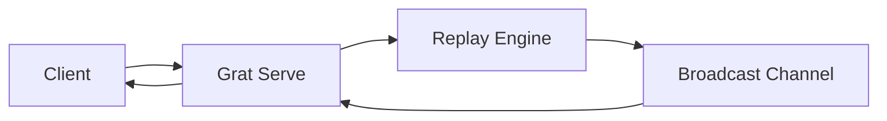

Embed the decoder in your application when you already have error data. Use the [streaming integration](#stream-live-traces) when your application needs live replay events.

## Build the JavaScript packages

From your Prism checkout, install `wasm-pack` with `cargo install wasm-pack` and add the Rust target with `rustup target add wasm32-unknown-unknown`. Build the package for each runtime into its own directory:

```bash
wasm-pack build crates/wasm --release --target web --out-dir pkg-web
wasm-pack build crates/wasm --release --target nodejs --out-dir pkg-node
```

The output directories are under `crates/wasm`. Each includes `grat_wasm.js`, `grat_wasm_bg.wasm`, TypeScript declarations, and npm package metadata. Install the appropriate directory from your third-party app with `npm install /path/to/Prism/crates/wasm/pkg-web` or the equivalent `pkg-node` path. The examples use the generated package name, `grat-wasm`.

| JavaScript API | Behavior |
| --- | --- |
| Default export for `web` | Async initializer. Call once before using the other exports and deploy the generated WASM binary with the glue module. |
| `decode_error(jsonString)` | Returns a JavaScript diagnostic report with fields such as `error_name`, `error_code`, and `summary`. The input is a normalized error object serialized as JSON. |
| `version()` | Returns the crate version. |
| `resolve_contract_error(wasmBytes, errorCode)` | Accepts a `Uint8Array` and unsigned 32-bit code. Currently returns a `not_yet_implemented` status. |

See the [WASM bridge reference](/wasm-bridge) for optional input fields and the report shape.

### React in the browser

This client-side component loads WASM the first time a user requests a decode. For server-rendered React frameworks, place it in a client component.

```jsx
import { useState } from "react";

let decoder;
function loadDecoder() {
  decoder ??= import("grat-wasm")
    .then(async (wasm) => {
      await wasm.default();
      return wasm;
    })
    .catch((error) => {
      decoder = undefined;
      throw error;
    });
  return decoder;
}

export function DecodeButton() {
  const [message, setMessage] = useState("");

  async function decode() {
    try {
      const wasm = await loadDecoder();
      const report = wasm.decode_error(
        JSON.stringify({ errorType: "Budget", errorCode: 50 }),
      );
      setMessage(report.summary);
    } catch (error) {
      setMessage(String(error));
    }
  }

  return (
    <>
      <button onClick={decode}>Decode example error</button>
      <p role="status">{message}</p>
    </>
  );
}
```

### Node.js

With the `nodejs` package installed, save this as `decode.cjs` and run `node decode.cjs`. The CommonJS glue loads the WASM binary when the package is required.

```js
const { decode_error, version } = require("grat-wasm");

const report = decode_error(
  JSON.stringify({ errorType: "Budget", errorCode: 50 }),
);
console.log(`Prism ${version()}: ${report.summary}`);
```

## Embed the native Rust crate

With a local Prism checkout, add the following to your application's `Cargo.toml`. Update the path to match the checkout location. The crate's default features include decoding and taxonomy.

```toml
[dependencies]
grat-core = { path = "../Prism/crates/core" }
serde_json = "1"
```

```rust
use grat_core::decode::{host_error::classify_error, report::build_report};

fn main() -> grat_core::GratResult<()> {
    let tx = serde_json::json!({ "status": "FAILED", "errorCode": 50 });
    let classified = classify_error(&tx)?;
    let report = build_report(&classified)?;
    println!("{}", report.summary);
    Ok(())
}
```

| Native API | Use |
| --- | --- |
| `decode::host_error::classify_error` and `decode::report::build_report` | Classify a failed transaction result and produce a `DiagnosticReport`. |
| `decode::MultiOpDecoder` | Decode individual operation failures from a transaction. |
| `spec::decoder::decode_contract_spec` and `spec::decoder::resolve_error_code` | Extract a contract spec from WASM and look up a custom error code. |
| `replay::replay_transaction(tx_hash, &network_config)` | Asynchronously reconstruct state and produce an execution trace. Requires the selected network's RPC and state sources. |

### Taxonomy loading and caching

- `TaxonomyDatabase::load_latest()` tries the taxonomy in the application's local Grat data directory and falls back to compiled-in definitions. It is a local load. The updater is a separate operation.
- Use `TaxonomyDatabase::load_embedded()` for deterministic built-in definitions or `load_from_dir(path)` for application-managed TOML files, then look up entries by category and code. The report builder calls `load_latest()` itself. The JavaScript exports have no custom taxonomy loader and use the embedded fallback in the browser.
- Native callers can wrap `cache::disk::DiskCache` in `cache::AsyncCache` and pass it to `decode::decode_with_cache(&cache, &tx_json).await`. The helper keys entries by the input's `hash`, so provide a real hash and use separate cache directories for different networks or taxonomy revisions.
- Browser callers can reuse the initialized module and manage result caching in JavaScript. If you persist reports, include the module version and the normalized input in the cache key.

## Stream live traces

Grat provides a WebSocket-based API for real-time transaction tracing.

## Overview

The streaming architecture allows you to receive incremental updates during long-running recomputations.



## Integration Steps

### 1. Start the Grat Server

Run the Grat server to expose the WebSocket endpoint:

```bash
grat serve --port 8080 --network mainnet
```

### 2. Connect via WebSocket

Connect your client to the server (e.g., using `tokio-tungstenite` in Rust or standard WebSockets in JavaScript).

```javascript
const ws = new WebSocket("ws://localhost:8080/ws");

ws.onopen = () => {
  ws.send(
    JSON.stringify({
      tx_hash: "abc123...",
    }),
  );
};
```

### 3. Handle Streamed Events

Handle the incoming JSON messages to update your UI or state.

<CodeGroup>
```javascript JavaScript
ws.onmessage = (event) => {
  const msg = JSON.parse(event.data);
  switch(msg.type) {
    case 'trace_started':
      console.log('Trace started...');
      break;
    case 'trace_node':
      updateTimeline(msg.node);
      break;
    case 'trace_completed':
      console.log('Done!');
      break;
  }
};
```
</CodeGroup>

## Performance Best Practices

- **Throttling**: Ensure your client can handle high-frequency updates (up to 200 messages per second).
- **Heartbeats**: Implement a ping/pong mechanism to detect connection drops.
- **Incremental UI**: Update your UI incrementally rather than re-rendering the entire execution tree on every message.
