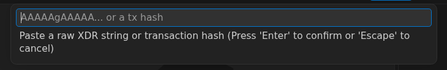
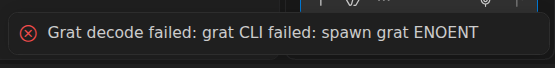

The Grat extension runs the `grat` CLI and opens the transaction report in VS Code. It requires VS Code 1.95 or later and a `grat` executable on the extension host's `PATH`. For Remote SSH, dev containers, or WSL, make the executable available in the remote environment. See the [CLI quickstart](/docs/quickstart).

## Decode a transaction

1. Open the Command Palette with **Ctrl+Shift+P** (**Cmd+Shift+P** on macOS).
2. Select **Grat: Decode Transaction Error**.
3. Paste a failed testnet transaction hash and press **Enter**. Press **Esc** to dismiss the prompt.

VS Code shows a progress notification while the CLI runs. On success, the extension opens an untitled, editable JSON document beside the active editor. The prompt also mentions XDR. To decode raw XDR, run `grat decode --raw` in the terminal with the XDR value, since the extension passes its input as a transaction hash.

## Editor providers and diagnostics panel

| Feature | Current behavior |
| --- | --- |
| Diagnostics | Registers a collection named `grat`. The collection receives no entries when decoding a transaction. |
| Quick Fix | Registers a Rust code action provider that returns an empty list. |
| Code Lens | Registers a Rust CodeLens provider that returns an empty list. |
| Hover | Registers a Rust hover provider that returns no tooltip. |
| Diagnostics panel | Declares the `grat.diagnostics` view type. Transaction reports open in the JSON editor. |

## CLI bridge and troubleshooting

The extension launches `grat` directly with `decode`, the input with surrounding whitespace removed, and `--output json`. The CLI defaults to testnet. To select a different network, run the CLI in a terminal with `--network`. The extension expects one JSON value on stdout and displays the process error or a JSON parsing error as a VS Code notification.

For `spawn grat ENOENT`, check that `grat --version` works in the extension host's environment, then restart VS Code so it inherits the updated `PATH`. For other errors, rerun the decode command with `--output json` in a terminal to inspect the CLI response.
